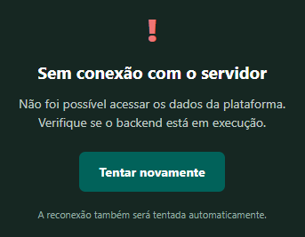

# Global Solution - Citizen Tech 🏙

André Bartolo (558319)  

Arthur Augutus (555106)  

## 🖥️ Descrição
A aplicação possui uma interface mobile/web em React Native com TypeScript integrada a uma API desenvolvida em Java com Spring Boot. O sistema permite o monitoramento de riscos urbanos, incluindo eventos registrados pelas pessoas da prórpia área, sensores urbanos e informações disponibilizadas por bases públicas.

O frontend se comunica com o backend através de requisições HTTP, utilizando principalmente o método GET para consultar os dados e verificar alterações automaticamente a cada 3 segundos. As informações são armazenadas em um banco de dados H2 com persistência em arquivo, garantindo que os registros sejam mantidos mesmo após a reinicialização da aplicação.

A interface foi projetada com foco na simplicidade, oferecendo um dashboard organizado em três painéis, com eventos urbanos sendo classificados automaticamente por prioridade e identificados por cores. O sistema também oferece opção de notificações de novos eventos e recuperação automática da conexão caso o backend fique temporariamente indisponível.

## ⚙️ Como iniciar o Backend

Para executar o Backend, é necessário possuir instalado:

* Java 17 (Backend)
* Maven (Backend)
* Node.js (Frontend)
* Expo (Frontend)

O projeto pode ser aberto em uma IDE compatível com Java e Spring Boot, como Visual Studio Code ou IntelliJ IDEA.

Após isso, o Backend pode ser iniciado executando o arquivo Java abaixo:

```text
Sprint1Application.java
```

Após a inicialização, o Backend estará disponível em:

```text
http://localhost:8080
```

## 📱 Como iniciar o Frontend

Para utilizar a integração completa, o Frontend tabém deve estar em execução. Abra a pasta do Frontend separadamente, e em um novo terminal execute:

```bash
npm install
npm start
```

Após iniciar o Expo, pressione:

```text
w
```

para abrir a aplicação no navegador. Por padrão, o Frontend estará disponível em:

```text
http://localhost:8081
```

O Backend e o Frontend devem permanecer executados simultaneamente durante o uso da aplicação, assim a imagem abaixo mostra como deve aparecer a página da aplicação:


## 🗃️ Banco de Dados H2

O banco de dados pode ser acessado através de:

```text
http://localhost:8080/h2-console
```

As configurações de conexão estão localizadas no arquivo:

```text
src/main/resources/application.properties
```

O H2 utiliza persistência em modo file, permitindo que os registros sejam mantidos após a reinicialização da aplicação.

O arquivo:

```text
src/main/resources/data.sql
```

contém registros iniciais utilizados para demonstração do sistema.

## 🔗 Integração Backend e Frontend

Após executar os dois processos, é realizada a integração entre as duas aplicações executadas simultaneamente:

```text
   Frontend Expo
http://localhost:8081
         ↓
 Fetch API (api.ts)
         ↓
 Backend Spring Boot
http://localhost:8080
         ↓
   Spring Data JPA
         ↓
         H2
``` 

O Frontend exibe as informações obtidas através da API do Backend. O arquivo `CorsConfig.java` configura o CORS, permitindo que o Frontend realize requisições HTTP ao Backend mesmo quando as aplicações são executadas em locais diferentes. A tela HomeScreen.tsx utiliza as funções disponíveis em api.ts para consultar os endpoints das três entidades: /eventos-urbanos, /sensores-urbanos e /bases-publicas. Além disso, o sistema utiliza o arquivo `UpcheckService.java` para verificar automaticamente a existência de alterações no banco de dados a cada 3 segundos.

```text
 HomeScreen.tsx
       ↓
     api.ts
       ↓
      Fetch
       ↓
Backend Spring Boot
       ↓
UpcheckService.java
       ↓
       H2
```
A prioridade dos eventos urbanos é definida pelo arquivo `AnalisePrioridadeService.java`, que analisa o tipo da ocorrência, o nível de confiança e a situação de resolução, e então é utilizado pela API e pelo Frontend para definir a cor e prioridade dos cartões de eventos. As notificações Push são implementadas através da API de notificações do navegador, mediante autorização do usuário, sendo exibidas quando novos eventos urbanos são detectados.

Quando o Backend é suspenso enquanto o Frontend continua em execução, é exibida a seguinte mensagem de erro:



Com as duas aplicações funcionando simultaneamente, o Frontend deve:

* listar os eventos e dados armazenados no Backend
* atualizar automaticamente a interface caso qualquer mudança do Backend seja detectada
* definir automaticamente a prioridade de cada evento urbano com base nas informações registradas
* oferecer a opção de notificações Push caso o usuário opte por ativar
* exibir o número total de registros em cada painel

## 🗂️ Estrutura do Projeto

```text
Advanced-Programming-Mobile-Dev/
├── Backend/
│   ├── src/
│   │   └── main/
│   │       ├── java/
│   │       │   └── GS2/
│   │       │       ├── config/
│   │       │       │   └── CorsConfig.java
│   │       │       ├── controller/
│   │       │       │   ├── EventoUrbanoController.java
│   │       │       │   ├── SensorUrbanoController.java
│   │       │       │   ├── BasePublicaController.java
│   │       │       │   └── Upcheck.java
│   │       │       ├── model/
│   │       │       │   ├── BasePublica.java
│   │       │       │   ├── EventoUrbano.java
│   │       │       │   └── SensorUrbano.java
│   │       │       ├── repository/
│   │       │       │   ├── EventoUrbanoRepository.java
│   │       │       │   ├── SensorUrbanoRepository.java
│   │       │       │   └── BasePublicaRepository.java
│   │       │       ├── service/
│   │       │       │   ├── AnalisePrioridadeService .java
│   │       │       │   ├── BasePublicaService.java
│   │       │       │   ├── EventoUrbanoService.java
│   │       │       │   ├── SensorUrbanoService.java
│   │       │       │   └── UpcheckService.java
│   │       │       └── GS2Application.java
│   │       └── resources/
│   │           ├── application.properties
│   │           └── data.sql
│   ├── pom.xml
│   └── mvnw
│
├── Frontend/
│   ├── assets/
│   │   └── icon.png
│   ├── src/
│   │   ├── components/
│   │   │   ├── InfoCard.tsx
│   │   │   └── OptionChips.tsx
│   │   ├── screens/
│   │   │   └── HomeScreen.tsx
│   │   ├── services/
│   │   │   └── api.ts
│   │   └── types/
│   │       ├── BasePublica.ts
│   │       ├── EventoUrbano.ts
│   │       └── SensorUrbano.ts
│   ├── App.tsx
│   ├── package.json
│   └── tsconfig.json
│
└── README.md
```

## 🎥 Vídeo demonstrativo

https://youtu.be/B3JWi5zaM6g

